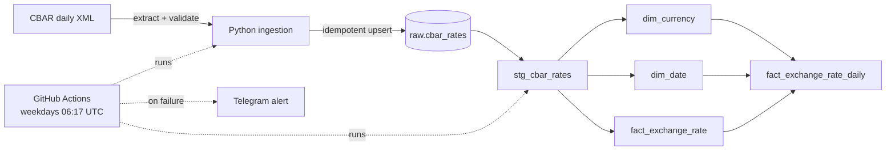

# FX Data Pipeline

An end-to-end data pipeline that collects official daily exchange rates from the **Central Bank of Azerbaijan (CBAR)**, loads them into a cloud data warehouse, models them into a tested star schema with dbt, and runs automatically every weekday on GitHub Actions. The pipeline is also containerized with Docker and can be orchestrated with Apache Airflow.

## Architecture



**ELT flow:**

1. **Extract** – download the CBAR XML file for each date, with timeouts and retries.
2. **Validate** – check every file before loading (row count, dates, duplicates, key currencies, positive rates).
3. **Load** – upsert into `raw.cbar_rates`, exactly as the source provides it.
4. **Transform** – dbt cleans the raw data and builds a star schema.
5. **Test** – dbt runs data tests and a source freshness check on every run.

## Tech stack

| Area | Tools |
|---|---|
| Ingestion | Python, requests, pandas, `xml.etree` |
| Storage | DuckDB (local development), MotherDuck (cloud production) |
| Transformation & testing | dbt Core with `dbt-duckdb` |
| Orchestration | GitHub Actions (production schedule), Apache Airflow 3 (local DAG) |
| Containerization | Docker |
| Alerting | Telegram Bot API |
| Version control | Git, GitHub |

## Data model

| Model | Type | Grain (one row per…) |
|---|---|---|
| `stg_cbar_rates` | view | currency per publication date (cleaned raw data) |
| `dim_currency` | table | currency |
| `dim_date` | table | calendar day |
| `fact_exchange_rate` | table | currency per CBAR publication date |
| `fact_exchange_rate_daily` | table | currency per calendar day |

**Key modeling decisions:**

- **Raw data is stored unchanged.** Dates stay as text and the nominal stays as `"1 t.u."` in the raw layer, so any cleaning bug can be fixed by re-running dbt without downloading anything again.
- **Rates are normalized per unit.** Some currencies are quoted per 100 units; staging divides by the nominal so every rate means "AZN per 1 unit".
- **Two fact tables, on purpose.**
  - `fact_exchange_rate` holds only what CBAR actually published. Use it for averages and rate-change analysis.
  - `fact_exchange_rate_daily` fills weekends and holidays with the last published rate, flagged with `is_carried_forward` and `rate_source_date`. Use it to convert transactions on any date.
- **`dim_date` is generated, not taken from the source**, so it includes weekends and holidays. `is_publication_day` shows which days CBAR actually published.
- **`dim_currency` tracks the life of each currency** with `first_seen_date`, `last_seen_date` and `is_active`, so currencies that CBAR added or stopped publishing are handled correctly.

## Reliability features

- **Idempotent loads** – a primary key on `(rate_date, currency_code)` plus an upsert means any day can be re-run safely, with no duplicates. This is what makes retries, backfills and overlapping runs safe.
- **Incremental mode** – each run checks the newest date already loaded and continues from there, re-loading the last day as a lookback window to catch late corrections.
- **Retries with exponential backoff** – network errors and `429`/`5xx` responses are retried; other `4xx` errors fail immediately.
- **Pre-load validation** – a suspicious file is rejected before it reaches the database.
- **Polite scraping** – weekdays only, with a pause between requests.
- **Data tests** – `not_null`, `unique`, `accepted_values` and `relationships` tests, plus custom tests for one row per currency per day, positive rates and stale carried-forward rates.
- **Source freshness** – warns when raw data is more than 3 days old and fails after 5 days.
- **Failure alerts** – any failed scheduled run sends a Telegram message with a link to the logs.
- **Pinned dependencies** – exact versions of DuckDB and dbt-duckdb, and a pinned runner OS, so every machine behaves the same.

## Project structure

```
fx-data-pipeline/
├── src/
│   ├── extract.py        # download (timeouts, retries) and parse CBAR XML
│   ├── validate.py       # pre-load checks on each file
│   ├── load.py           # idempotent upsert into raw.cbar_rates
│   ├── main.py           # one day: fetch → parse → validate → load
│   └── backfill.py       # date ranges: incremental or manual (--start/--end)
├── dbt/
│   ├── dbt_project.yml
│   ├── profiles.yml      # dev = local DuckDB, prod = MotherDuck
│   ├── models/
│   │   ├── staging/      # source definition + stg_cbar_rates
│   │   └── marts/        # star schema
│   └── tests/            # custom singular tests
├── airflow/
│   └── dags/
│       └── fx_pipeline_dags.py   # Airflow DAG: extract_load → source_freshness → dbt_build
├── .github/workflows/
│   └── daily_pipeline.yml
├── Dockerfile
├── .dockerignore
└── requirements.txt
```

## Running locally

```bash
# 1. Set up the environment
python -m venv .venv
source .venv/bin/activate
pip install -r requirements.txt

# 2. Load data (incremental: from the newest loaded date to today)
python src/backfill.py

#    or a specific range
python src/backfill.py --start 2024-03-01 --end 2024-03-31

# 3. Transform and test
cd dbt
dbt source freshness
dbt build
```

By default everything runs against a local DuckDB file (`data/fx.duckdb`).

## Running with Docker

The image packages Python, the pinned dependencies, the ingestion code and the dbt project. Its default command runs the incremental load and then `dbt build`.

```bash
# Build the image
docker build -t fx-pipeline .

# Run against the local database (the data folder is mounted as a volume)
docker run --rm -v "$(pwd)/data:/app/data" fx-pipeline

# Run the same image against MotherDuck (production)
docker run --rm \
  -e FX_DB_PATH=md:fx_pipeline \
  -e DBT_TARGET=prod \
  -e motherduck_token \
  fx-pipeline
```

- **Volumes** keep the data outside the container, so it survives after the container is removed.
- **Environment variables** choose the database and dbt target at run time; the token is passed in from the host and never stored in the image.
- **Layer caching:** dependencies are installed before the code is copied, so code changes rebuild in seconds.

## Orchestration with Airflow (local)

`airflow/dags/fx_pipeline_dags.py` defines the same pipeline as an Airflow DAG with three dependent tasks:

```
extract_load  >>  source_freshness  >>  dbt_build
```

- Weekday schedule (`17 6 * * 1-5`, UTC), `catchup=False`
- Two retries per task with a 5-minute delay
- `max_active_runs=1`, so two runs never write to the same DuckDB file at once
- Tasks call the project's own virtual environment, keeping Airflow's dependencies separate from the pipeline's

To try it locally, install Airflow 3 in a **separate** virtual environment (using the official constraints file), then:

```bash
export AIRFLOW_HOME=~/airflow-lab/airflow_home
export AIRFLOW__CORE__LOAD_EXAMPLES=False
export AIRFLOW__CORE__DAGS_FOLDER=/path/to/fx-data-pipeline/airflow/dags
airflow standalone
```

Then open http://localhost:8080, unpause `fx_pipeline` and trigger it. The paths in the DAG point to a local checkout; in production the tasks would typically run the Docker image instead.

## Environments

The same code runs locally and in production; only configuration changes.

| | Local (dev) | Production |
|---|---|---|
| Database | `data/fx.duckdb` | MotherDuck `md:fx_pipeline` |
| Python setting | `FX_DB_PATH` not set | `FX_DB_PATH=md:fx_pipeline` |
| dbt target | `dbt build` | `dbt build --target prod` |
| Credentials | — | `motherduck_token` environment variable |

## Scheduled runs

`.github/workflows/daily_pipeline.yml` runs every weekday at 06:17 UTC (10:17 Baku time) and can also be started manually. Each run:

1. installs pinned dependencies,
2. loads new CBAR data into MotherDuck,
3. checks source freshness,
4. builds and tests all dbt models,
5. sends a Telegram alert if any step fails.

The schedule uses an odd minute because GitHub's scheduled events are best-effort: runs at the top of the hour are the most likely to be delayed or skipped.

Required repository secrets: `MOTHERDUCK_TOKEN`, `TELEGRAM_BOT_TOKEN`, `TELEGRAM_CHAT_ID`.

## Data source

Official exchange rates published by the Central Bank of the Republic of Azerbaijan, one XML file per date:
`https://cbar.az/currencies/DD.MM.YYYY.xml`

Each file contains bank metals and foreign currencies. On weekends and holidays CBAR returns the file of the last working day, which the primary key and upsert absorb automatically.
